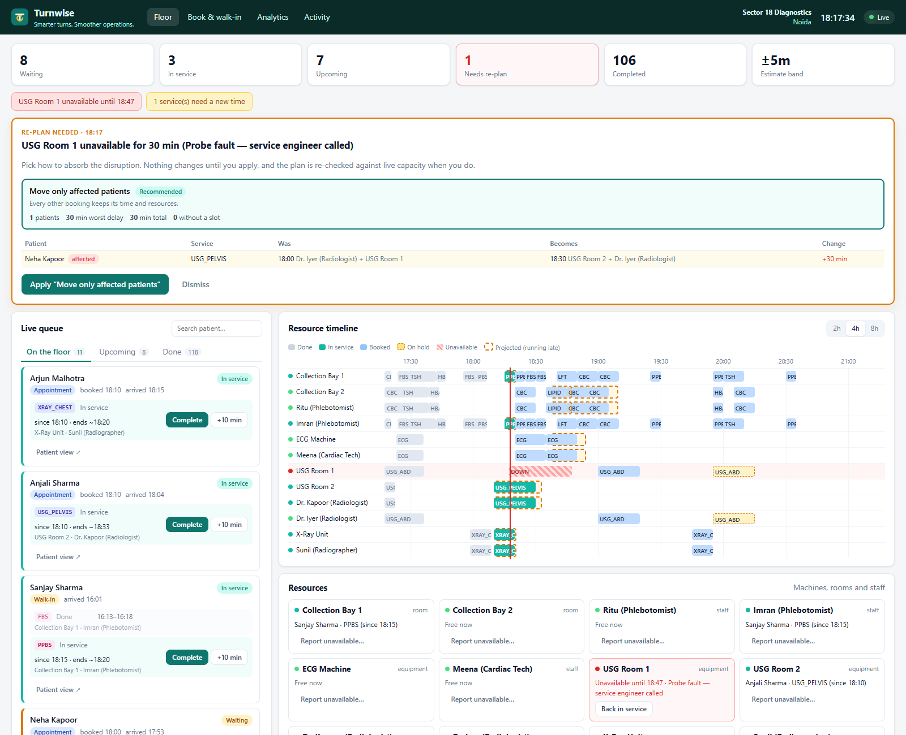
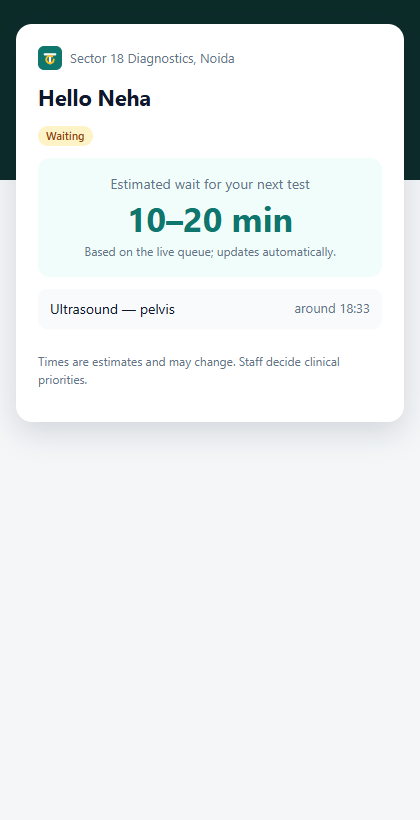
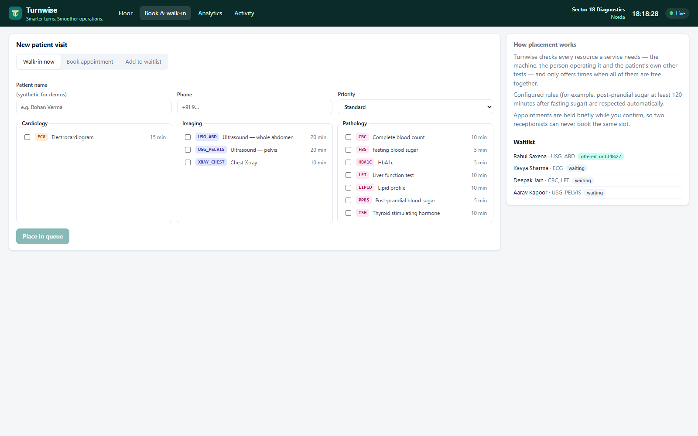
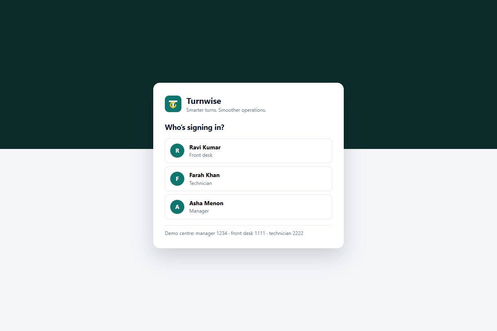
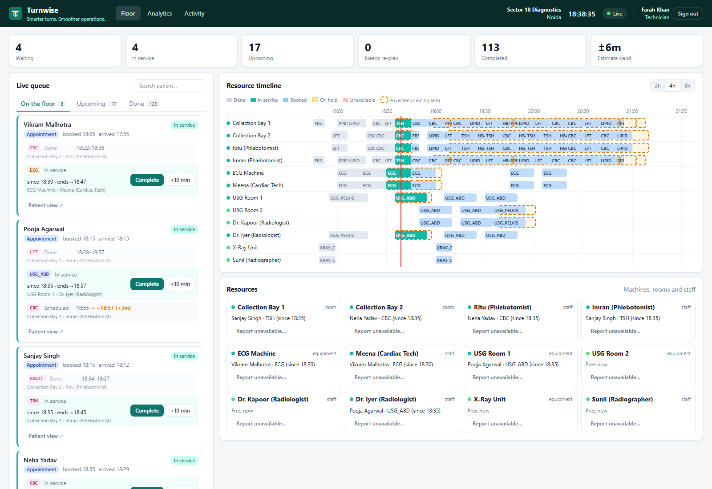
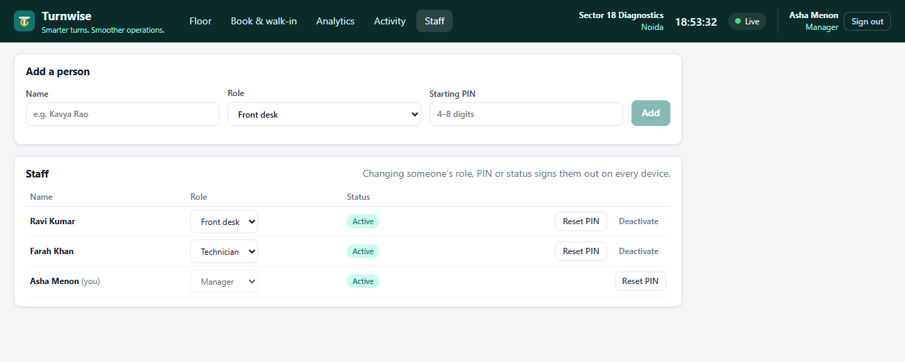
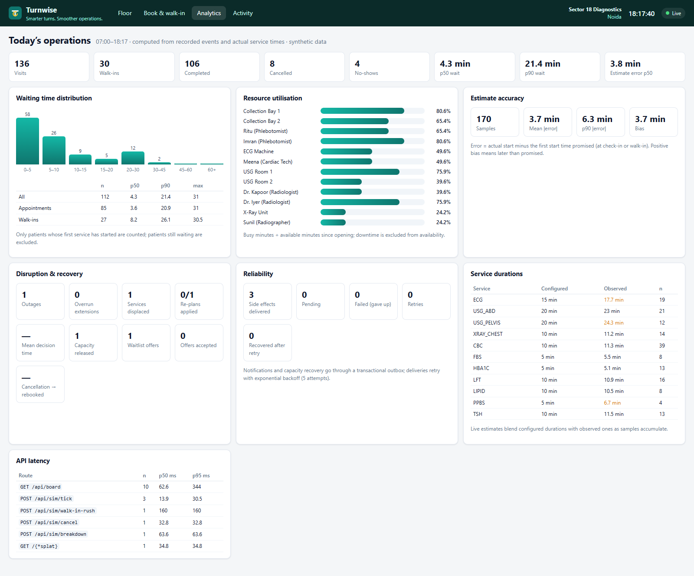

# Turnwise

**Smarter turns. Smoother operations.**

Turnwise is a live operating system for a diagnostic centre's limited resources: machines, rooms and the staff who run them. It is not an appointment-booking app. It treats appointments and walk-ins as one queue, places every test only when *all* the resources it needs are free together, and keeps the plan honest as reality drifts. When a machine breaks, a service overruns or a patient cancels, staff get a concrete, checked alternative to approve instead of a phone call and a spreadsheet.

Stack: **PERN in plain JavaScript**. That is PostgreSQL, Express 5, React (Vite) and Node, plus Redis/BullMQ for background work and Server-Sent Events for live updates. All patient data is synthetic.



## What it does

| Area | Behaviour |
| --- | --- |
| Unified queue | Appointments and walk-ins share one plan. Walk-ins are fitted into real gaps, never "squeezed in". |
| Resource-aware placement | A test needs a machine, a room and a qualified person at the same time. The patient can't be in two places at once, and rules like "post-prandial sugar ≥ 120 min after fasting sugar" are enforced. |
| Holds | Receptionists get a short hold while the patient confirms. Expired holds release capacity automatically. |
| Live estimates | Delays propagate through each resource's queue. Waits are shown as a range calibrated by the centre's own recent estimate error. |
| Disruptions | Downtime, overruns and late starts displace only the bookings they actually break. A re-plan proposal offers options ("move only affected patients" vs "keep queue order") with their cost in delay. Nothing changes until staff apply it, and it is re-validated against live capacity at that moment. |
| Late resource binding | When staff start a service and the booked machine, room or person is busy (an overrun, an outage) or booked for someone else, Turnwise swaps in an interchangeable one that is free for the whole service instead of making the patient wait or bumping the other booking. |
| Next up | The floor shows who to call now: patients who are present and whose test can start immediately, ordered by when they were due (appointment time, or arrival for walk-ins). An early-arriving appointment doesn't overtake a walk-in who is already waiting. Suggestions never take a resource that is down, in use or booked for someone due earlier; if a later booking would have to move, the card says so. |
| Baseline comparison | Analytics replays today's demand through a paper-token "department queue" system with identical service durations, so the effect of the policy is measured, not asserted. |
| Capacity recovery | Cancellations and no-shows release capacity. A worker offers the slot to a compatible waitlisted patient with a time-limited link. |
| Patient view | A token link shows the next test, a wait range and any pending offer. It updates live. |
| Analytics | Wait p50/p90, utilisation, estimate error, disruption counts, cancellation → rebooked time, delivery reliability and API latency. All of it is computed from recorded events. |

<p>
  
  
</p>

<p>
  
  
</p>

<p></p>



## Quick start

Requires Node 22+ (24 recommended) and Docker.

```bash
npm install
npm run infra:up      # Postgres :5433, Redis :6380
cp .env.example .env  # optional; defaults match docker-compose
npm run setup         # migrate + seed a synthetic Noida centre
npm run dev           # API :4100, worker, web :5173
```

Open http://localhost:5173 and sign in with one of the demo staff accounts:

| Person | Role | PIN | Can |
| --- | --- | --- | --- |
| Asha Menon | Manager | 1234 | Everything, including the simulator and the **Staff** screen (add people, change roles, reset PINs, deactivate) |
| Ravi Kumar | Front desk | 1111 | Walk-ins, bookings, check-in, cancellations, waitlist, approving re-plans |
| Farah Khan | Technician | 2222 | Start, complete and extend services; report machines unavailable |

Everyone can see the floor, analytics and activity.

### Run everything in containers

```bash
SESSION_SECRET=$(openssl rand -base64 32) docker compose --profile app up --build -d
docker compose run --rm api node server/src/seed.js   # synthetic demo day
```

This starts Postgres, Redis, a one-shot `migrate` job, the API (which also serves the dashboard) and the worker. Open http://localhost:8080, or set `TURNWISE_PORT` if 8080 is taken. The image runs as a non-root user with `NODE_ENV=production`, so session cookies are marked `Secure`. Serve it over HTTPS anywhere other than localhost. For a production-style run, use `npm run build`, then `npm start` and `npm run start:worker` with `NODE_ENV=production` and a `SESSION_SECRET`. The API serves the built UI at http://localhost:4100.

| Command | Purpose |
| --- | --- |
| `npm test` | Planner, projection, comparison, Postgres integration and HTTP auth tests (Vitest) |
| `npm run lint` | ESLint over server and web |
| `npm run loadtest` | Concurrency stress test against an isolated temporary centre |
| `npm run seed` | Reset to a fresh synthetic day (148-ish visits, 12 resources, 11 services) |

### Five-minute demo

1. **Floor**: sign in as Asha (manager). In *Simulate a morning*, turn on **Floor autopilot**. Patients arrive, start and finish, and the timeline and estimates move live.
2. Click **Ultrasound breaks down**. The busiest ultrasound room goes down for 30 minutes. Affected bookings are flagged and a re-plan proposal appears with the cost of each option. Apply it, and the patient's link updates to the new time.
3. Click **Walk-in rush**. Three walk-ins arrive concurrently and each is fitted into a real gap.
4. Click **Patient cancels**, then look at **Book & walk-in → Waitlist**. A compatible waitlisted patient receives a time-limited offer.
5. Open **Analytics** and **Activity** to see the measured effect and the audit trail.

## Architecture

```
React (Vite) ── REST ──▶ Express API ──▶ PostgreSQL  (source of truth)
     ▲                        │              │  exclusion constraints, outbox, events
     └──── SSE (/api/stream) ◀┘◀── LISTEN ───┘  pg_notify on every recorded event
                                              
BullMQ worker ── expire holds · relay outbox → notifications / capacity recovery · sweep overruns
     ▲
   Redis (jobs only, never booking truth)
```

```
server/
  migrations/001_init.sql   schema, exclusion constraints, notify trigger
  src/domain/               pure planner, delay projection and policy comparison (no I/O, unit tested)
  src/services/             booking, operations, replan, waitlist, board, analytics, simulator
  src/live.js               SSE hub with Last-Event-ID replay
  src/worker.js             BullMQ workers and repeatable jobs
  src/loadtest.js           concurrency stress test
web/src/                    React dashboard, booking, analytics, activity, patient pages
```

## Design decisions worth defending

**1. Double-booking is impossible at the database level, not just unlikely.**
Every reservation is a `tstzrange` on a resource. A GiST exclusion constraint rejects any two *active* reservations (held, confirmed or in use) that overlap on the same resource. A second constraint stops one visit's steps from overlapping, so a patient can't be in two rooms at once. Planning is serialised per centre with a transaction-scoped advisory lock to keep contention cheap, but correctness never depends on it. If the lock is bypassed, the constraint still wins. The loser gets either a 23P01 violation or, when conflicting inserts collide mid-flight, a 40P01 deadlock abort on the exclusion index. Both become a clean 409 or a bounded retry. Redis is never consulted for booking truth.

**2. Side effects are durable before they happen.**
Booking changes, audit events and outbox rows are written in one transaction. A relay moves outbox rows into BullMQ with deterministic job ids (5 attempts, exponential backoff). Notification delivery is idempotent through a unique `outbox_id`, so a retry after a crash can't text a patient twice. Capacity recovery marks its outbox row delivered *inside* the transaction that makes the offer. Failed deliveries are visible in Analytics. Delivery fails randomly 15% of the time by default (`NOTIFY_FAILURE_RATE`) so the retry path is exercised all the time.

**3. Disruption recovery is a proposal, not a silent rewrite.**
When capacity disappears, only the bookings that actually conflict are displaced. The planner, a pure list scheduler with backtracking resource assignment, builds options and scores them. The score orders by fewest unschedulable patients, then smallest worst-case delay, then smallest total delay. Options that would strand someone are dropped, and anything that can't be placed today is reported explicitly with a reason. Applying a proposal re-checks step versions and live constraints. A stale proposal is marked stale and regenerated rather than half-applied. Short overruns (below `OVERRUN_GRACE_MIN`, default 5 min) only show up as projected delay, so staff aren't asked to approve noise.

**Who did what is not self-reported.** Staff sign in with a PIN (scrypt-hashed). The server issues an HMAC-signed, HttpOnly, SameSite=Lax session cookie, and the audit actor is taken from that session. A per-person session version is bumped on sign-out, which revokes every outstanding token for that person. Failed sign-ins are rate-limited per client. Every staff request acts on the signer's own centre, and each mutation is gated by role. When a manager changes someone's role, PIN or active status, that person's session version moves on, so they lose access on every device immediately rather than when a token expires. A centre can't be left without an active manager, and managers can't demote or deactivate themselves. Both checks run under a row lock, so two managers can't demote each other at the same moment.

**Live updates survive reconnects.** Events are rows first. A trigger calls `pg_notify`, and the SSE hub forwards it. A reconnecting browser sends `Last-Event-ID` and gets the missed events replayed from the table, or a `reset` if it was gone too long.

## Measured results

From `npm run loadtest` on a laptop (Windows, Dockerised Postgres 16). 50 clients race for 400 holds on 20 contested slots, where each slot needs 2 resources. Then 60 concurrent walk-ins run.

| Metric | Result |
| --- | --- |
| Double bookings | **0** |
| Holds won / max possible | 40 / 40 (360 clean 409 conflicts, 0 other errors) |
| Concurrent walk-ins placed | 60 / 60 |
| Hold latency p50 / p95 | 655 ms / 1437 ms |
| Throughput | ~64 holds/s |

These latencies are dominated by queueing behind the per-centre planning lock under deliberately extreme contention, with 50 simultaneous writers to one centre. Under normal use the API latency panel shows board reads around 60 ms p50 and mutations in the tens of milliseconds.

### Turnwise vs department queues

`GET /api/analytics/baseline` (and the top panel on Analytics) replays today's patients through two policies with identical arrivals, tests and service durations (8 seeded duration draws). Waiting excludes clinically required gaps, such as 120 min between fasting and post-prandial sugar. On a seeded demo day partway through (138 visits):

| Metric (lower is better) | Department queues | Turnwise |
| --- | --- | --- |
| Median wait, everyone | 8.3 min | 4.7 min |
| 90th percentile wait, everyone | 36.0 min | 32.5 min |
| 90th percentile wait, appointments | 37.7 min | 33.8 min |
| 90th percentile wait, walk-ins | 28.2 min | 26.6 min |
| 90th percentile time in centre | 79.7 min | 65.4 min |
| Patients waiting over 30 min | 14.9% | 10.9% |
| Overtime after closing | 18.1 min | **26.4 min** |

Three findings came out of building this:

- **Rigid timetables lose.** The first version, which made staff follow the plan to the minute, was *worse* than paper tokens. The gain comes from treating the plan as a reservation while staff start whoever is present and ready.
- **Late binding is the biggest lever.** Without it, Turnwise lost to paper tokens on median wait in 6 of 8 draws. With it, Turnwise wins all 8. That result is why late binding is in the product, not just the model.
- **Who you call next matters for walk-ins.** Calling the earliest-*planned* patient let early-arriving appointments overtake walk-ins who were already waiting, and the walk-in 90th-percentile wait was 44 min against 28 min for paper tokens. Calling whoever was *due* first (appointment time, or arrival for walk-ins) brings it to 27 min, and Turnwise then wins on every wait metric. That is the rule behind **Next up**.

The cost is visible too. Turnwise finishes about 8 minutes later after closing. Paper tokens reward patients who arrive very early, so their long chains of tests (CBC, then LFT, then lipid profile) start sooner. Weighting the queue by chain length cut the overtime to 21 min but made the slowest appointments wait longer, so it isn't shipped. This is a policy choice the comparison makes measurable.

On the seeded synthetic day, estimate error is around 4 min p50 and 6 min p90. These figures come from synthetic durations, so they show the measurement pipeline works rather than real-world accuracy. Stage 4 of the plan (a controlled pilot against a baseline) is what would make them meaningful.

## Limitations and next steps

- Single centre, single day horizon. Planning is greedy list scheduling with local backtracking, not a global optimiser.
- Sign-in is PIN-based for a shared front-desk terminal, and the rate limiter is in-memory per API process. A multi-site deployment would want SSO, a shared limiter, and staff management screens (staff are created by the seed today).
- Notifications are simulated. In production an SMS/WhatsApp provider would sit behind the same outbox.
- Clinical priority is a staff decision. Turnwise orders by the priority staff set and never infers it.

## Data

Every name, phone number and visit is generated deterministically by the seed and simulator. Do not load real patient records into this project.
